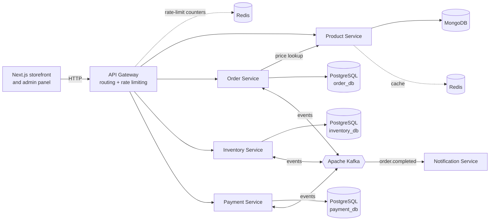
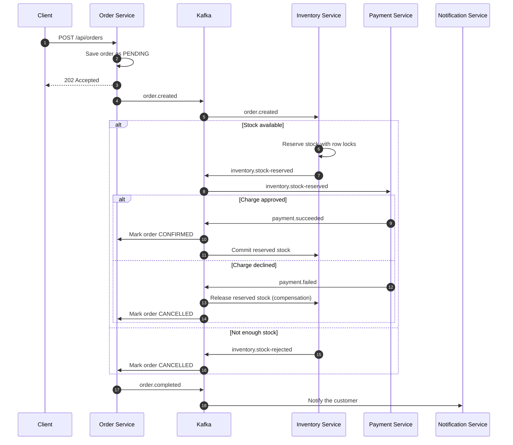
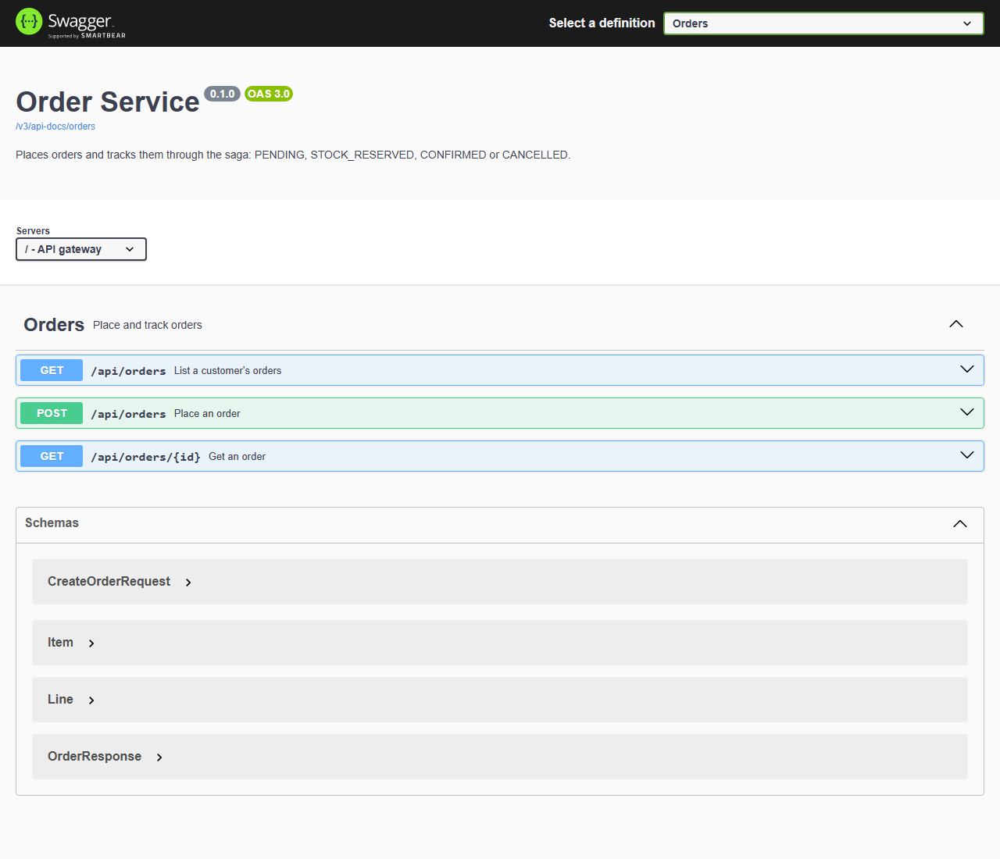

# EzDelivery – Event-Driven Grocery Platform

[](https://github.com/NileshSree1072/ezdelivery-microservices/actions/workflows/ci.yml)

Spring Boot microservices backend for the EzDelivery grocery storefront
([ezdelivery](https://github.com/NileshSree1072/ezdelivery)) and admin panel
([ezdeliveryadmin](https://github.com/NileshSree1072/ezdeliveryadmin)).

> 🚧 Work in progress. Stages 1–5 are complete (see the roadmap below).

**Tech stack:** Java 17 · Spring Boot 3.3 · Spring Cloud Gateway · Apache Kafka · PostgreSQL ·
MongoDB · Redis · Flyway · Docker Compose · JUnit 5 · Testcontainers · GitHub Actions · OpenAPI/Swagger

## Architecture



Both Redis boxes are the same Redis instance, drawn twice for readability.
Each service owns its data (database-per-service). Services talk synchronously only where an
immediate answer is required (the order service looks up current prices); everything else
flows through Kafka events.

## How an order works (Saga pattern over Kafka)

Placing an order touches three services that each own their own database, so a single
database transaction is impossible. Instead, each service does its local step and publishes
an event; the next service reacts to it (choreography). If a later step fails, earlier steps
are undone by **compensating actions**.



**Reliability decisions**

| Problem | Solution |
|---|---|
| Kafka can deliver the same event twice | Every consumer is idempotent: `UNIQUE(order_id)` on reservations and payments, and redelivered events reuse the stored result instead of acting again |
| Two orders racing for the last unit | `SELECT ... FOR UPDATE` row locks on inventory, taken in a fixed order to avoid deadlocks |
| Events for one order arriving out of order | Order status only moves forward (`PENDING → STOCK_RESERVED → CONFIRMED/CANCELLED`); late or stale events are ignored, and `@Version` optimistic locking stops concurrent overwrites |
| A message that keeps failing | Retried 3 times, then moved to a `<topic>.DLT` dead-letter topic so it cannot block the partition |
| Ordering per order | Every event is keyed by `orderId`, so all events for one order go to the same partition |
| Client tampering with prices | The order service fetches the current price from the product service; the client only sends product IDs and quantities |

## Services

| Service | Port | Responsibility | Storage |
|---|---|---|---|
| `api-gateway` | 8080 | Single entry point, routing, rate limiting | Redis |
| `product-service` | 8081 | Product catalog | MongoDB + Redis cache |
| `inventory-service` | 8082 | Stock levels and reservations | PostgreSQL (`inventory_db`) |
| `order-service` | 8083 | Order lifecycle | PostgreSQL (`order_db`) |
| `payment-service` | 8084 | Stripe payments | PostgreSQL (`payment_db`) |
| `notification-service` | 8085 | Order notifications | – |

Infrastructure: Kafka (KRaft mode), Redis, PostgreSQL, MongoDB. All run with Docker Compose.
Shared event contracts and Kafka settings live in the `common` module.

## Run locally

Requirements: Java 17 and Docker.

```bash
./mvnw package -DskipTests      # Windows: mvnw.cmd package -DskipTests
docker compose up -d --build
```

Check that everything is up:

```bash
curl http://localhost:8080/actuator/health
```

## API documentation

Interactive docs for every service are served through the gateway at
**http://localhost:8080/swagger-ui.html**. Pick a service from the dropdown and use
"Try it out" to send real requests through the gateway.



## API (via gateway, port 8080)

| Method | Path | Description |
|---|---|---|
| GET | `/api/products?categoryId=` | List products (optional category filter) |
| GET | `/api/products/{id}` | Get a product |
| POST | `/api/products` | Create a product |
| PUT | `/api/products/{id}` | Update a product |
| DELETE | `/api/products/{id}` | Delete a product |

| PUT | `/api/inventory/{productId}` | Set available stock `{"availableQuantity": 10}` |
| GET | `/api/inventory/{productId}` | Available and reserved stock |
| POST | `/api/orders` | Place an order. Returns `202 Accepted` with status `PENDING` |
| GET | `/api/orders/{id}` | Order with its current status |
| GET | `/api/orders?email=` | A customer's orders, newest first |
| GET | `/api/payments/order/{orderId}` | Payment for an order |

### Try the full flow

```bash
# 1. Create a product and give it stock
curl -X POST http://localhost:8080/api/products -H "Content-Type: application/json" \
  -d '{"title":"Organic Bananas","price":60.00}'
curl -X PUT http://localhost:8080/api/inventory/<productId> -H "Content-Type: application/json" \
  -d '{"availableQuantity":10}'

# 2. Place an order (202 Accepted, status PENDING)
curl -X POST http://localhost:8080/api/orders -H "Content-Type: application/json" \
  -d '{"customerEmail":"you@example.com","customerName":"You","items":[{"productId":"<productId>","quantity":3}]}'

# 3. A moment later the saga has finished: CONFIRMED
curl http://localhost:8080/api/orders/<orderId>
```

The local mock payment provider declines charges above Rs. 10,000
(`PAYMENT_MOCK_DECLINE_ABOVE`), which is an easy way to watch the compensation path:
the order is cancelled and its reserved stock is returned.

## Caching and rate limiting (Redis)

**Product cache (cache-aside).** `GET /api/products/{id}` and product lists are served from
Redis, falling back to MongoDB on a miss. Updates refresh the cached product (`@CachePut`),
and creates/updates/deletes evict cached lists, so a price change is visible immediately.
Entries expire after 10 minutes (lists after 2) as a safety net. If Redis goes down, reads fall
back to MongoDB instead of failing.

Measured with 1,000 reads of 20 popular products from 10 concurrent clients:

| | MongoDB queries | Median latency |
|---|---|---|
| Cache off (`PRODUCT_CACHE_TYPE=none`) | 1,000 | 23.6 ms |
| Cache on | **0** | 23.6 ms |

The cache removes all repeat reads from the database. Latency is unchanged in this local setup
because most of each request is Docker networking on the host; the gain is database capacity.

**Rate limiting.** The gateway applies a token bucket per client IP, stored in Redis so every
gateway instance shares the same counters: 20 requests/second with bursts up to 40
(`RATE_LIMIT_PER_SECOND`, `RATE_LIMIT_BURST`). Extra requests get `429 Too Many Requests`,
and every response carries `X-RateLimit-Remaining`. In a test burst of 100 requests,
40 passed and 60 were rejected; the bucket refilled within 2 seconds.

## Testing

```bash
./mvnw verify      # needs Docker running: integration tests start real containers
```

28 tests across the services. Integration tests use **Testcontainers** to start real
PostgreSQL, MongoDB, Redis and Kafka, so they exercise the same Flyway schema, row locks
and serialization that run in production. GitHub Actions runs the full suite on every push
and pull request, then builds all Docker images.

| Service | What is tested |
|---|---|
| `order-service` | Status rules (forward-only, final states), server-side pricing, `order.created` published, confirmation and cancellation driven by Kafka events, out-of-order events |
| `inventory-service` | All-or-nothing reservation, duplicate events, compensation on payment failure, **20 concurrent buyers for 5 units sell exactly 5** |
| `payment-service` | Charge once per order, declined payments, `UNIQUE(order_id)` enforced by the database |
| `product-service` | Reads served from Redis, update refreshes the cache, delete and create evict correctly |

The concurrency test is checked against a deliberately broken build: with the row lock
removed, it fails with an optimistic-locking conflict.

## Known limitations

- **Dual write when placing an order.** The order service saves the order and then publishes
  `order.created`. If the process crashes between those two steps, the order stays `PENDING`.
  The standard fix is the **Transactional Outbox** pattern: write the event to an `outbox`
  table in the same database transaction, and let a relay publish it to Kafka.
- **Payments use a mock provider locally.** Stripe (test mode) plugs into the same
  `PaymentGateway` interface when the Next.js checkout is connected.

## Roadmap

- [x] Stage 1 – Multi-module project, API gateway, Docker Compose infrastructure, product catalog API
- [x] Stage 2 – Kafka order saga with compensation, idempotent consumers, dead-letter topics and Flyway migrations
- [x] Stage 3 – Redis caching and gateway rate limiting
- [x] Stage 4 – Tests (JUnit, Testcontainers) and GitHub Actions CI
- [x] Stage 5 – Architecture diagrams and OpenAPI docs (combined Swagger UI on the gateway)
- [ ] Stage 6 – k6 load testing
